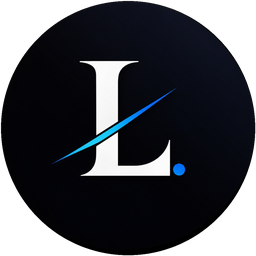

<div align="center">
  

  # ⚡ Kami Likhith — The Vibe Coder Portfolio
  
  **A high-energy, neo-brutalist developer portfolio engineered with React 19, Vite, Framer Motion, and Tailwind CSS.**

  <p align="center">
    <a href="https://devlikhith.vercel.app/" target="_blank">
      
    </a>
    <a href="https://react.dev/" target="_blank">
      
    </a>
    <a href="https://vitejs.dev/" target="_blank">
      
    </a>
    <a href="https://tailwindcss.com/" target="_blank">
      
    </a>
    <a href="https://motion.dev/" target="_blank">
      
    </a>
    <a href="https://github.com/likhith3035/my-portfolio/blob/main/LICENSE" target="_blank">
      
    </a>
    <a href="https://vercel.com/analytics" target="_blank">
      
    </a>
  </p>

  <p align="center">
    <a href="#-interactive-features--easter-eggs">Explore Features</a> •
    <a href="#-cinematic-executive-name-intro">Executive Intro</a> •
    <a href="#-keyboard-shortcuts">Keyboard Shortcuts</a> •
    <a href="#-tech-stack">Tech Stack</a> •
    <a href="#-project-directory-structure">Architecture</a> •
    <a href="#-featured-projects">Featured Projects</a> •
    <a href="#-local-development">Local Setup</a> •
    <a href="#-connect-with-me">Connect</a>
  </p>
</div>

---

## 🌟 Overview

Welcome to **The Vibe Coder** portfolio experience. This portfolio is engineered to stand out from generic developer portfolios through **bold neo-brutalist typography, dynamic fluid glassmorphism, micro-interactions, responsive 60 FPS mobile performance, and surprise interactive easter eggs**.

It serves as both an interactive personal brand showcase and an engineering playground highlighting full-stack projects, machine learning models, cybersecurity tools, and hackathon accomplishments.

---

## ⚡ Interactive Features & Easter Eggs

### 🍎 1. Executive Masked Name Reveal & Regional Greetings
- Features an Apple Keynote-grade typographic masked reveal on initial visit (`AppleHelloIntro.jsx` and `AppleNameEffect.jsx`).
- Uses precision horizontal clipping plane rises, an expanding architectural baseline with diamond anchor, and a brushed titanium light sheen.
- Cycles through 6 regional Indian languages (English, Telugu, Hindi, Tamil, Kannada, Malayalam) in a synchronized 4.0s cadence.

### ⌨️ 2. Spotlight Command Palette (`Ctrl + K` / `Cmd + K`)
- Instant keyboard-first navigation modal (`CommandPalette.jsx`).
- Jump directly to sections (Projects, About, Experience, Support), trigger modals, inspect credentials, or activate hidden themes without scrolling.

### 🎨 3. Multi-Accent Theme & Interactive Love Mode
- **Dark & Light Mode:** Fully synced with system preference and persisted across sessions using `localStorage`.
- **Dynamic Accent Themes:** Switch between energetic neo-brutalist `Orange` and an interactive `Love` theme.
- **Particle Click Reaction:** In `Love` mode, clicking anywhere triggers an animated fountain of hearts and sparkles (`FloatingHeartsOverlay.jsx`).

### 🤖 4. Built-in Recruiter AI Chatbot
- An interactive assistant (`ChatBot.jsx`) embedded directly into the interface.
- Instant Q&A for recruiters and engineering managers covering technical proficiencies, education background (B.Tech AI & Data Science at NBKRIST), hackathon awards, and project architectures.

### 🟢 5. Cyberpunk Matrix Rain Overlay
- Fullscreen canvas digital rain effect (`MatrixRain.jsx`) accessible directly from the command palette or easter egg triggers.

### 🍱 6. Bento Grid & Live Modal Previews
- Modern asymmetric bento layout (`ProjectBentoCard.jsx` and `FlagshipShowcase.jsx`).
- Interactive screenshot inspection (`ProjectScreenshotModal.jsx`) allowing deep dives into system diagrams and UI workflows without leaving the page.
- Direct PDF resume viewing (`ResumeModal.jsx`) and official certification verification (`CredentialModal.jsx`).

---

## ⌨️ Keyboard Shortcuts

| Shortcut | Action | Scope |
| :--- | :--- | :--- |
| <kbd>Ctrl</kbd> + <kbd>K</kbd> / <kbd>Cmd</kbd> + <kbd>K</kbd> | Open Spotlight Command Palette | Global |
| <kbd>Esc</kbd> / <kbd>Space</kbd> / <kbd>Enter</kbd> | Skip intro preloader animation immediately | Intro Screen |
| <kbd>Esc</kbd> | Dismiss any open modal (Contact, Resume, Palette, Screenshots) | Global |
| <kbd>Click</kbd> *(in Love Theme)* | Spawn floating heart / sparkle particle stream | Global |

---

## 🛠️ Tech Stack

```text
┌────────────────────────────────────────────────────────────────────────┐
│                      KAMI LIKHITH PORTFOLIO STACK                      │
├──────────────────┬───────────────────┬──────────────────┬──────────────┤
│ Frontend Core    │ Styling & UI      │ Motion & Optics  │ Integrations │
│ • React 19       │ • Tailwind CSS    │ • Framer Motion  │ • Web3Forms  │
│ • Vite 8 (Rolld) │ • Glassmorphism   │ • Masked Horizon │ • Vercel Web │
│ • ESNext JS      │ • React Icons     │ • Canvas Matrix  │ • Analytics  │
└──────────────────┴───────────────────┴──────────────────┴──────────────┘
```

- **Frontend Core:** [React 19](https://react.dev/) + [Vite 8](https://vitejs.dev/) for lightning-fast HMR and small production bundles.
- **Styling:** [Tailwind CSS](https://tailwindcss.com/) with custom neo-brutalist utility classes, dark-mode tokens, and CSS variables.
- **Motion & Physics:** [Framer Motion](https://motion.dev/) (v12/v13) for scroll-triggered reveals, spring physics, and cursor spotlight effects.
- **Forms & Serverless:** [Web3Forms](https://web3forms.com/) for zero-backend contact dispatch directly to email.
- **Monitoring & Analytics:** [@vercel/analytics](https://vercel.com/analytics) for real-time traffic and Web Vitals metrics.

---

## 📂 Project Directory Structure

```text
portfolio/
├── public/                     # Static icons, favicons, project media
│   └── favicon.svg
├── src/
│   ├── assets/                 # Brand assets and graphics
│   ├── components/             # 28+ Modular React UI components & modals
│   │   ├── About.jsx               # Bio, timeline, education & interactive tech pills
│   │   ├── AppleHelloIntro.jsx     # Cinematic preloader with regional Indian greetings
│   │   ├── AppleNameEffect.jsx     # Executive masked typographic reveal & brushed sheen
│   │   ├── ChatBot.jsx             # AI recruiter chatbot assistant
│   │   ├── CommandPalette.jsx      # Cmd+K Spotlight search & action launcher
│   │   ├── ConfettiOverlay.jsx     # Canvas confetti celebration trigger
│   │   ├── ContactModal.jsx        # Web3Forms serverless contact interface
│   │   ├── CredentialModal.jsx     # Verified certification credential inspector
│   │   ├── CustomCursor.jsx        # Physics-based custom cursor
│   │   ├── Experience.jsx          # Hackathons, leadership & career milestones
│   │   ├── FlagshipShowcase.jsx    # Hero spotlight showcase for flagship builds
│   │   ├── FloatingHeartsOverlay.jsx # Interactive love-theme click particles
│   │   ├── LiquidGlassNav.jsx      # Liquid glass floating navigation bar
│   │   ├── MatrixRain.jsx          # Matrix digital rain canvas overlay
│   │   ├── ProjectBentoCard.jsx    # Responsive neo-brutalist bento cards
│   │   ├── ProjectScreenshotModal.jsx # Multi-image gallery & architectural viewer
│   │   ├── Projects.jsx            # Filterable project catalog
│   │   ├── ResumeModal.jsx         # Interactive in-browser resume viewer
│   │   └── SpotlightCursor.jsx     # Radial gradient cursor follower
│   ├── data/                   # Decoupled project, education & experience datasets
│   │   ├── education.jsx           # Academic degrees, coursework & certifications
│   │   ├── experience.jsx          # Internships, hackathon awards & achievements
│   │   └── projects.jsx            # Detailed project specs, features & workflows
│   ├── utils/                  # Helper utilities and motion transitions
│   ├── App.jsx                 # Root layout with lazy-loaded Suspense boundaries
│   ├── index.css               # Tailwind directives, theme variables & animations
│   └── main.jsx                # Vite React application entry point
├── .env.example                # Template for environment variables
├── package.json                # Project dependencies and build scripts
├── tailwind.config.js          # Tailwind theme configurations and color tokens
└── vite.config.js              # Vite bundler options and plugins
```

---

## 🏆 Featured Projects

| Project | Focus Domain | Architecture & Highlights | Links |
| :--- | :--- | :--- | :--- |
| **CampusIQ** | AI · Data Science | **KPMG in India Hackathon** · Early warning student analytics with multi-factor risk scoring ($S^3$), $k$-Means clustering, SHAP explainability, and WhatsApp alerts. | [Live Demo](https://learnonva.vercel.app/) · [GitHub](https://github.com/likhith3035/smart-campus) |
| **StudentHub** | Full Stack · PWA | **National Finalist @ HackPrix S3** · 36-hour sprint campus collaboration PWA integrating Sarvam AI voice assistant, notes sharing, and smart pipelines. | [Live Demo](https://gensync-78.vercel.app/) · [GitHub](https://github.com/likhith3035/StudentHub) |
| **SV Care Diagnostics** | Healthcare · Web | **ISO 9001:2015 Production Platform** · 100+ test clinical catalogue, WhatsApp photo prescription quotes, home booking, and Telugu/English localization. | [Live Demo](https://svcarehealthdiagnostics.vercel.app/) · [GitHub](https://github.com/likhith3035/svcare) |
| **Secure Vault** | Cybersecurity · Python | **Desktop Cryptography** · AES-256-CBC folder encryption suite with randomized filename obfuscation and Gmail API automated OTP authentication. | [GitHub](https://github.com/likhith3035/secure-vault-folder-encryption) |
| **Incog Talkk** | WebSockets · WebRTC | **Privacy First** · Zero-registration anonymous P2P real-time chat with room signaling, zero persistent logs, and sub-100ms sync. | [Live Demo](https://incogtalkk.netlify.app/) · [GitHub](https://github.com/likhith3035/livetalkbylikki) |
| **Hostel Portal** | Cloud · React | **Campus Living Portal** · Room allocations, automated mess menu schedules, and issue ticketing built on React and Firebase Firestore. | [Live Demo](https://nbkristhostelportal.netlify.app/) · [GitHub](https://github.com/likhith3035/hostel-portal-2) |

---

## 💻 Local Development

Follow these steps to run the portfolio locally:

### 1. Prerequisites
Ensure you have the following installed:
- [Node.js](https://nodejs.org/) (version `18.x` or higher recommended)
- [npm](https://www.npmjs.com/) or [pnpm](https://pnpm.io/)

### 2. Clone the Repository
```bash
git clone https://github.com/likhith3035/my-portfolio.git
cd my-portfolio
```

### 3. Install Dependencies
```bash
npm install
```

### 4. Configure Environment Variables
Create a local `.env` file from the provided `.env.example`:
```bash
# macOS / Linux / Git Bash
cp .env.example .env

# Windows PowerShell
Copy-Item .env.example .env
```

Open `.env` and set your Web3Forms access key:
```env
# Web3Forms Access Key (Get yours free in 10s at https://web3forms.com)
VITE_WEB3FORMS_ACCESS_KEY=your_access_key_here
```

> **Note:** If omitted, the contact modal will still open, but live message delivery will be disabled.

### 5. Start the Development Server
```bash
npm run dev
```
Visit `http://localhost:5173` in your browser.

---

## 📜 Available Scripts

| Command | Action |
| :--- | :--- |
| `npm run dev` | Starts the Vite local development server with instant Hot Module Replacement (HMR). |
| `npm run build` | Compiles and optimizes assets into the `dist/` directory for production deployment. |
| `npm run preview` | Locally boots a web server previewing the generated production `dist/` build. |
| `npm run lint` | Runs ESLint 9 to validate code quality and check for lint errors across components. |

---


---

## 🎬 Cinematic Rack-Focus Name Intro

The portfolio launches with a film-grade **optical rack-focus title card** centered on **`KAMI LIKHITH`**:

- **Optical Camera Focus Pull:** Smoothly resolves from high-aperture optical lens blur ($32\text{px}$) to sub-pixel clarity at exact screen dead center ($X=50\%, Y=50\%$).
- **Sub-Pixel Optical Centering:** Letter-spacing compensation (`pl-[0.34em] sm:pl-[0.42em]`) counteracts CSS tracking bias for mathematical horizontal and vertical symmetry.
- **Metallic Liquid Sheen:** A diagonal light sweep reflects across the assembled typography once focus resolves.
- **Expanding Laser Horizon:** An ultra-thin anamorphic horizon line with radiant diamond core bead.
- **Regional Indian Greetings:** Bottom-left rolling ticker cycling through **English (`Hello`), Telugu (`నమస్కారం`), Hindi (`नमस्ते`), Tamil (`வணக்கம்`), Kannada (`ನಮಸ್ಕಾರ`), and Malayalam/Kerala (`നമസ്കാരം`)**.
- **Dual-Tone Luxury Contrast:** Deep `#070709` OLED obsidian in Dark Mode; crisp `#09090B` Obsidian Carbon on `#FAF9F6` luxury linen in Bright Mode.
- **Instant Skip Controls:** Tap anywhere, or press `ESC`, `Space`, or `Enter` to seamlessly transition to the main interface.

## ⚡ Performance & Mobile Optimizations

- **Dynamic Code-Splitting:** All resource-heavy overlays (`CommandPalette`, `ChatBot`, `MatrixRain`, `ContactModal`, `ResumeModal`, `ConfettiOverlay`) are loaded asynchronously via `React.lazy()` and `Suspense`, keeping the initial bundle size exceptionally light.
- **Adaptive 60 FPS Mobile Rendering:** Heavy GPU-taxing filters (SVG noise grain, complex parallax stacks) automatically disable on mobile viewports for fluid scrolling.
- **Scroll Position Integrity:** Scroll restoration is explicitly configured to reset cleanly to top upon fresh reloads.
- **Modern Semantic SEO:** Comprehensive Open Graph meta tags, Twitter card tags, and `schema.org` JSON-LD structured data for fast search indexing.

---

## 📬 Connect with Me

<div align="center">
  <a href="https://linkedin.com/in/likhith-kami" target="_blank">
    
  </a>
  <a href="https://github.com/likhith3035" target="_blank">
    
  </a>
  <a href="mailto:kamilikhith@gmail.com" target="_blank">
    
  </a>
  <a href="https://www.instagram.com/lucky__likhith" target="_blank">
    
  </a>
</div>

<br />

<div align="center">
  <sub>Built with ❤️ and continuous caffeine by <b>Kami Likhith</b>. Licensed under the <a href="./LICENSE">MIT License</a>.</sub>
</div>
